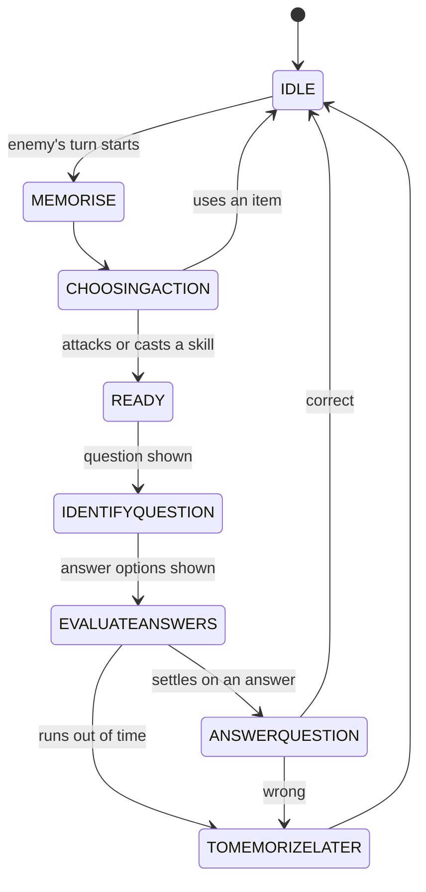

# Kanamoji: selected scripts

Selected C# scripts from **Kanamoji**, my final year project. It's a Unity turn-based battle game for learning the Japanese kana. Every attack is a quiz question, and you race an AI enemy to answer it. The enemy learns the kana during the battle as well, so it gets faster and more accurate the longer you fight it.

- **Portfolio page (video, screenshots):** https://amirulrsly.github.io/#work/kanamoji
- **Playable demo:** https://amirulrsly.itch.io/amirulrsly-fyp-demo

These are excerpts, not a buildable project. The scenes, art, audio and the rest of the code aren't included.

## Where to start

**[`EnemyAIBrain.cs`](Scripts/EnemyAIBrain.cs)**: the enemy AI, which was the focus of the project.

## How the enemy AI works

The enemy is a finite state machine. Each frame, `Update` runs the current state, and each state hands over to the next.

**Knowledge.** Every kana has a knowledge score that starts low and is capped.

**Recognising an option.** The AI looks at the answer options one at a time, and each look takes time. For each option it rolls 0 to 50 against its knowledge of that kana:
- **Under the score:** it recognises the kana and knows whether this option is right.
- **Over the score:** it guesses.

If it believes more than one option, it keeps the one whose kana it knows best.

**Reaction time.** How long each look takes depends on how well it knows the kana being asked, so well-known kana are answered faster. If the player has already answered, it hurries. In the timed skill rounds it also speeds up as the timer and the remaining questions run down.

**Learning.** At the start of each of its turns it studies:
- the whole lesson a little;
- the kana it recently got wrong much more, with the latest mistake studied hardest.

It only keeps the last few mistakes in mind, so it improves over a battle but can still be beaten.

**Choosing an action.** A short priority list: heal HP with an item at half health, restore MP with an item when it runs low, cast Cure at a quarter health, otherwise attack.

## The files

| File | What it does |
|---|---|
| [`EnemyAIBrain.cs`](Scripts/EnemyAIBrain.cs) | The enemy AI: state machine, knowledge model, answering and action choice |
| [`BattleManager.Questions.cs`](Scripts/BattleManager.Questions.cs) | Builds each question and its answer options. Runs the attack question, and the skill's three rounds that get harder (2, then 4, then 8 options) |
| [`SkillSystem.cs`](Scripts/SkillSystem.cs) | The skill menu and skill effects. A skill's strength depends on how well the caster did in its question rounds |
| [`ItemHandler.cs`](Scripts/ItemHandler.cs) | Both battlers' item bags, the item menu and item effects |
| [`StatusEffectSystem.cs`](Scripts/StatusEffectSystem.cs) | Ticks down status effects (such as Attack Up) each turn and removes them when they expire |
| [`BarAnimation.cs`](Scripts/BarAnimation.cs) | HP, MP and Burst bars. When a bar drops, the front fill drops at once and the back fill catches up after a short pause |

`BattleManager` is one component split across several files with `partial class`. Only the question part is included here.

## Notes

- Built in Unity with C#, using LeanTween for UI animation and TextMeshPro for text.
- I first wrote this as a student project in 2023. In 2026 I went back and cleaned it up: I refactored the large battle and AI scripts, removed dead code, and fixed several bugs I found along the way.
